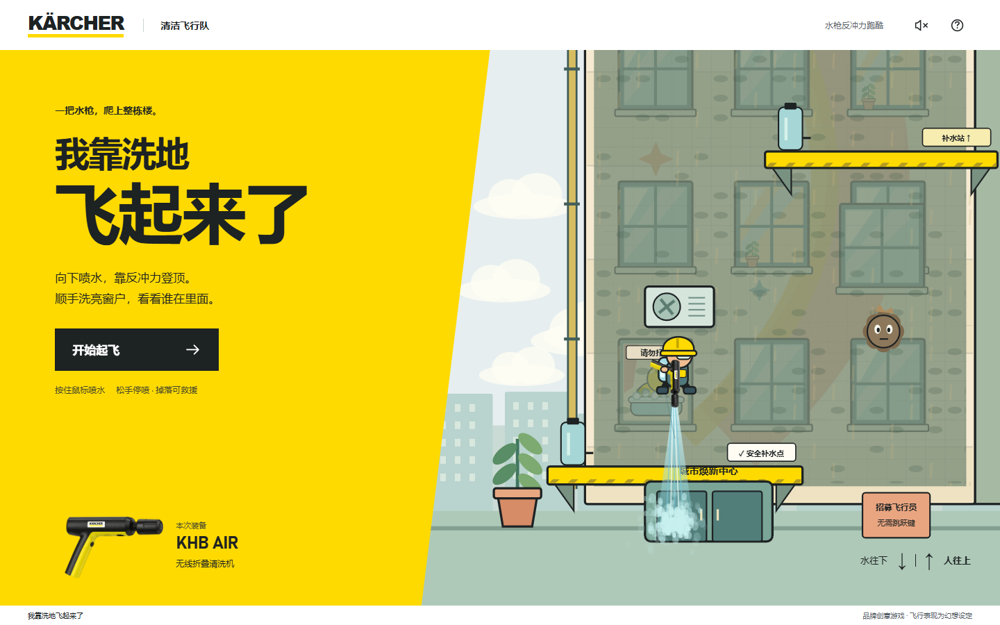
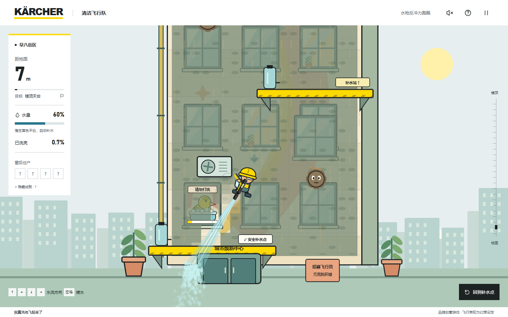
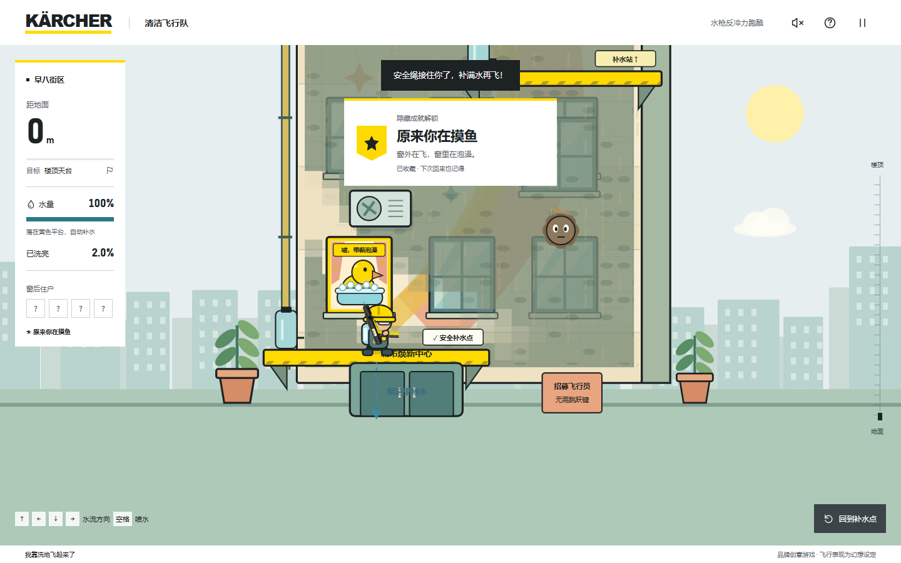
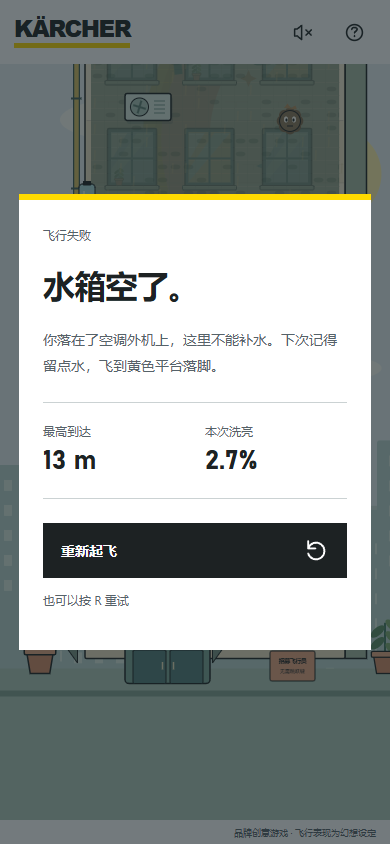
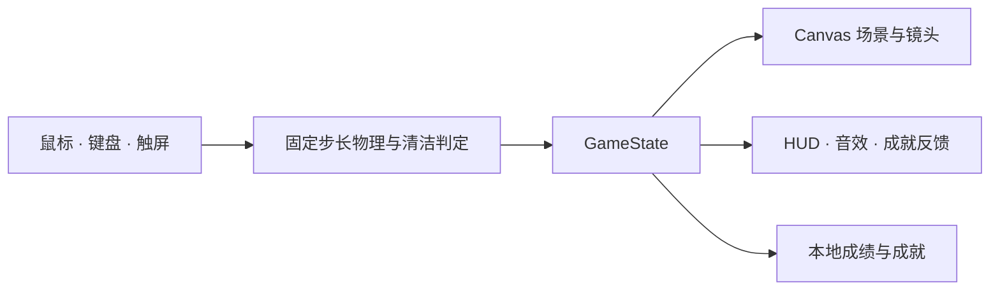

<div align="center">

# 我靠洗地飞起来了

**水往下，人往上。**

一把水枪、一箱水，用反冲力爬上摩天楼。顺手洗亮窗户，发现楼里的秘密。

[](https://waytoagi-fly-games.vercel.app)

[](LICENSE)
[](package.json)
[](package.json)
[](package.json)

[直接试玩](https://waytoagi-fly-games.vercel.app) · [快速开始](#快速开始) · [操作说明](#操作说明) · [项目文档](#项目文档)

</div>

[](https://waytoagi-fly-games.vercel.app)

## 一箱水，能飞多高？

这里没有跳跃键。瞄准水流的方向，角色就会被推向反方向；同一股水流还能洗掉墙面的污渍。飞得更高，还是多洗一扇窗，都取决于你怎么花掉这箱水。

- **靠反冲力登顶**：斜向喷射调整路线，绕开空调外机，落到黄色平台补水。
- **把脏窗变成故事**：局部清洁会逐渐露出四位住户，还有一扇写着「请勿打扰」的窗。
- **给冒险留张纪念**：登顶后镜头拉远，揭晓全楼画作，生成本局专属 PNG 海报。
- **玩过的，浏览器记得**：个人最佳和隐藏成就本地保存。无需账号，支持鼠标、键盘和触屏。

一栋完整楼宇，**7 个补水点 · 6 个空调障碍 · 6 个泥团 · 4 位住户**。



<details>
<summary><strong>更多画面：隐藏成就与手机端</strong>（含彩蛋剧透）</summary>

### 藏在脏窗后面的摸鱼现场

洗亮指定窗户，解锁「原来你在摸鱼」。收藏会保存在当前浏览器，重玩后也可以再次发现。



### 手机操作与失败重试

拖动摇杆控制水流。水用尽后落在空调外机上，本局结束；点击「重新起飞」再试一次。

<p align="center">
  
</p>

</details>

## 操作说明

| 操作 | 鼠标 / 键盘 | 手机 / 触屏 |
| --- | --- | --- |
| 瞄准并喷水 | 鼠标瞄准，按住左键；或方向键选水流方向，空格喷水 | 拖动右下摇杆 |
| 停止喷水 | 松开左键或空格 | 松开摇杆 |
| 补水 | 落在黄色平台，停止喷水 | 同左 |
| 回到补水点 | 点击「回到补水点」 | 点击「救援」 |
| 暂停 / 音效 | `P` / `Esc` 暂停，`M` 切换音效 | 点击顶部按钮 |
| 重新开始 | 游戏中按 `R` 确认重玩；失败后按 `R` 直接重试 | 在暂停或失败界面重试 |

**水流的方向，和角色移动的方向相反。** 向左下喷水，就会往右上飞。

空中断水和侧面擦碰不会直接结束游戏，空水落到黄色平台仍能补水；**水用尽后落在空调顶部，则本局失败**。飞行中的救援保留已清洁区域，失败后重新开始新局。

### 飞行评级

| 条件 | 奖励 |
| --- | --- |
| 落在楼顶天台 | ★ |
| 实际洁净度达到 35% | 再加 ★ |
| 发现至少 3 位住户 | 再加 ★ |

画作揭晓只负责展示，洁净度始终按你实际清除的污渍计算。音效默认关闭，可自行开启。

## 快速开始

需要 **Node.js 22.14+** 和 npm。

```bash
git clone https://github.com/dandan1232/WaytoAGI-fly-games.git
cd WaytoAGI-fly-games
npm ci
npm run dev
```

打开终端输出的本地地址。游戏运行不依赖 CDN、外部字体、模型接口或后端服务。

### 开发与验证

| 命令 | 用途 |
| --- | --- |
| `npm run dev` | 启动本地开发服务器 |
| `npm run check` | TypeScript 类型检查 |
| `npm test` | 物理、清洁、碰撞、失败与本地存储测试 |
| `npm run test:e2e` | 真实浏览器输入、完整通关、触摸与界面回归 |
| `npm run test:ui` | 六种屏幕尺寸的布局、操作区与弹窗检查 |
| `npm run build` | 类型检查并构建到 `dist/` |
| `npm run preview` | 预览生产构建 |
| `npm run test:production` | 对比线上资源并验证匿名游玩流程 |

浏览器测试使用本机安装的 Google Chrome；本地测试服务器由 Playwright 自动启动。生产验证会将当前构建与线上版本比较，适合在部署对应版本后运行。

## 技术结构

**TypeScript + Vite + Canvas 2D**，原生 HTML/CSS 构建界面，Web Audio 合成音效。物理使用固定 1/120 秒时间步，渲染与判定分离。



```text
src/
├── core.ts          物理、碰撞、清洁、发现与胜负判定
├── level.ts         楼宇、平台、空调、住户和彩蛋
├── render.ts        Canvas 场景、摄像机、粒子与海报
├── input.ts         鼠标、键盘与触摸输入
├── main.ts          游戏流程、界面与生命周期
├── storage.ts       本地成绩与成就收藏
├── audio.ts         合成水流和反馈音效
├── style.css        首屏、仪表、触屏和菜单
└── assets/          本地产品插画
```

## 项目文档

| 文档 | 内容 |
| --- | --- |
| [需求与验收](docs/requirements.md) | 玩法范围、迭代需求与验收条件 |
| [技术架构](docs/architecture.md) | 数据流、状态机、物理、清洁与存储 |
| [界面设计](docs/ui-direction.md) | 卡赫黄、工业感与街机界面的设计约定 |
| [素材来源](docs/visual-assets.md) | KHB AIR 图样参考与生成提示 |
| [验证记录](docs/verification.md) | 逻辑、浏览器与生产验证证据 |
| [Vercel 部署](docs/deployment.md) | 构建配置与线上发布记录 |

## 许可证与素材

项目原创源码与文档采用 **[MIT License](LICENSE)**，可以在遵循许可证的前提下使用、修改和分发。

Kärcher / 卡赫品牌标识、产品形象及相关素材不包含在项目的 MIT 授权中；具体范围见 [NOTICE](NOTICE)。这是基于品牌 brief 的独立创意游戏，反冲飞行为幻想设定。

<div align="center">

[现在就飞一次 →](https://waytoagi-fly-games.vercel.app)

</div>
